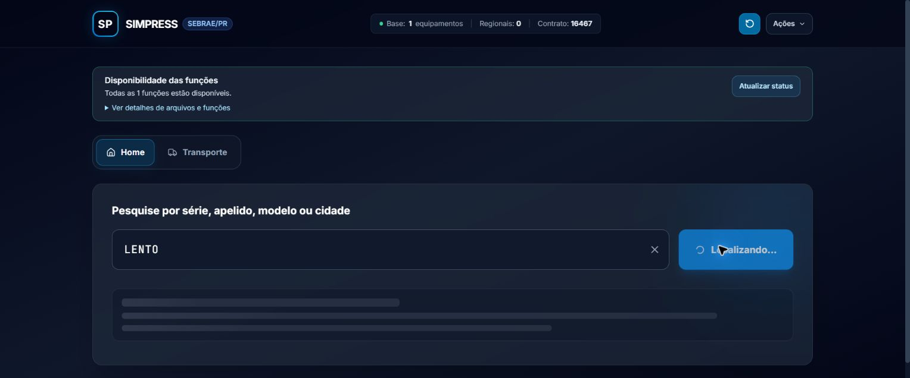

# Microinterações da interface

Implementadas em 08/10/2026. Os módulos da interface usam JavaScript puro; Playwright e axe-core são dependências de desenvolvimento usadas apenas nas verificações automatizadas.

## Organização

- `static/ui-motion.js`: API reutilizável de animação, cancelamento, carregamento e validação.
- `static/ui-motion.css`: tokens de duração/easing, feedback de controles e skeletons.
- `static/accessible-dialogs.js`: rótulos, foco inicial, ciclo de Tab, Escape, fechamento de detalhes e retorno de foco.
- `static/ui-notifications.js`: criação e anúncio das notificações com entrada e saída animadas.
- `static/app.js`: orquestra os módulos com os fluxos reais do sistema.
- `tests/e2e/ui.spec.cjs`: testes em Chromium, acessibilidade e perfil de cadência; a fixture usa somente respostas e anotações fictícias.

| Interação | Comportamento |
| --- | --- |
| Home ↔ Transporte | Entrada com deslocamento de 8 px e fade em 220 ms. A troca de estado é imediata. |
| Modais | Entrada em 220 ms; fechamento em 180 ms. O fechamento desabilita a interação imediatamente. |
| Drawers | Preset horizontal de 24 px, ativado por `data-motion="drawer"` no overlay. A aplicação atual usa modais; nenhum novo drawer foi acrescentado ao produto. |
| Botões | Pressão de 1 px e transições explícitas em 160 ms. Botões desabilitados não se deslocam. |
| Inputs | Transição de borda e feedback de validação em 160 ms; indicação acessível com `aria-invalid`. |
| Notificações | Entrada em 220 ms e saída em 180 ms, mantendo os anúncios acessíveis. |
| Carregamento | Skeleton na consulta de equipamento, pesquisa completa/paginação e nos dois históricos. Aparece após 150 ms, evitando flashes em respostas rápidas. |

O shimmer usa um ciclo de 1.500 ms para manter o carregamento discreto. Esse ciclo não aumenta o tempo de resposta nem atrasa a exibição de dados. Não há animação individual das linhas de tabelas extensas.

## Exemplos de uso

```js
const motion = window.SimpressMotion;

// Depois de tornar o painel visível, sem esperar pela animação:
motion.reveal(panel, "page");

// Carregamento que não remove resultados já exibidos:
const stopLoading = motion.startLoading(list, "Carregando resultados…", { rows: 3 });
try {
  const response = await fetch(url);
  if (!response.ok) throw new Error("Falha ao carregar resultados.");
  const data = await response.json();
  stopLoading();
  renderResults(data);
} finally {
  stopLoading(); // Idempotente; cobre falhas e cancelamentos.
}
```

No Simpress, use `abrirModalAcessivel` e `fecharModalAcessivel` para abrir e fechar os diálogos: elas cuidam de rótulos, foco inicial, Escape, Tab e retorno de foco, além de chamar o módulo visual. A API de movimento sozinha não substitui esse gerenciamento de acessibilidade.

O módulo cancela a animação anterior do mesmo elemento. Reabrir um overlay durante a saída cancela o fechamento pendente. Um carregamento antigo não remove o skeleton nem o estado ocupado de um carregamento mais recente.

## Performance e acessibilidade

- Animações de entrada, saída e shimmer usam apenas `transform` e `opacity`.
- Não há leituras de geometria, reflow forçado ou JavaScript executado a cada frame no módulo.
- Não há `will-change` permanente. Efeitos e referências das animações são liberados ao terminar ou cancelar.
- As propriedades CSS de transição são explícitas, inclusive nos controles existentes com `transition-all`.
- `prefers-reduced-motion` desativa o movimento e o shimmer. Alterar a preferência durante uma saída também finaliza o fechamento.
- Navegadores sem Web Animations continuam abrindo e fechando os componentes imediatamente.

O perfil E2E coleta 179 intervalos de `requestAnimationFrame` em repouso e durante trocas de aba, espera o carregamento de rede e fontes, desativa tracing para não incluir a instrumentação e observa tarefas longas. Removi o desfoque de fundo apenas dos dois cartões grandes da transferência depois de medir uma primeira pintura lenta. Na execução isolada local no Chromium/Windows a 1.366 × 900, a mediana foi 16,7 ms e o p95 16,8 ms tanto em repouso quanto durante trocas repetidas; o maior intervalo foi 49,9 ms. O handler de clique mais lento levou 1,9 ms, e a amostra registrou uma tarefa de 58 ms junto à primeira exibição do painel. Já no perfil executado em paralelo com a matriz completa E2E, o p95 chegou a 33,4 ms, o intervalo máximo a 116,7 ms e houve uma tarefa de 113 ms na primeira troca para a aba ainda não exibida. Isso aponta custo de renderização inicial do painel oculto, embora os handlers sigam rápidos. O perfil verifica p95 abaixo de 34 ms, mantém quadros acima de 50 ms abaixo de 2% e bloqueios abaixo de 250 ms; esses limites monitoram responsividade, mas não certificam 60 FPS em outros equipamentos nem substituem um trace de GPU em dispositivos de produção.

## Verificação de usabilidade

| Cenário | Resultado |
| --- | --- |
| Troca de abas com clique e seta esquerda | Seleção, painel e foco corretos. |
| Busca real e troca para Transporte | Equipamento e série preservados. |
| Busca vazia | Aviso acessível e foco na pesquisa. |
| Abrir histórico e consultar resultado | Novo modal recebe foco; o histórico anterior fecha. |
| Modal de atualização: Shift+Tab e Escape | Foco permanece dentro do diálogo; ao fechar, volta para o acionador visível ou para o resumo do menu quando o acionador anterior não está visível. |
| axe-core: Home desktop/mobile e resultado modal | Nenhuma violação WCAG 2.2 A/AA encontrada nas áreas auditadas. |
| Preferência de movimento reduzido | Modais continuam abrindo e fechando por teclado. |
| Trocas repetidas de aba | Perfil isolado: p95 de 16,8 ms; perfil integrado à matriz paralela: p95 de 33,4 ms e pausa de 113 ms ao exibir o painel pela primeira vez. |
| Resposta lenta com dados fictícios | Skeleton visível e botão ocupado. |
| HTTP 503 simulado | Mensagem de erro exibida, botão liberado e skeleton removido. |
| Limpar durante a requisição | Campo vazio, botão liberado e carregamento cancelado. |
| Layout de 390 px e 1.366 px | Sem overflow horizontal na página nos estados verificados. |
| Console no aplicativo real | Nenhum erro da aplicação nos fluxos verificados; mensagens de extensão do Chrome foram desconsideradas. |

Os testes no navegador foram verificações técnicas de fluxos; não constituem pesquisa com usuários ou avaliação por leitor de tela. Nenhum inventário, anotação ou cadastro operacional foi modificado pelos testes de interface.

Testes de fluxo ficam no Node; os cenários de browser instalam Chromium e axe-core. A auditoria axe verifica os critérios automatizáveis WCAG 2.2 A/AA em desktop e mobile; ela não substitui avaliação manual com leitores de tela ou testes com usuários.

```powershell
npm ci
node --test tests/test_transfer_workflows.cjs tests/test_inventory_ui_flows.cjs tests/test_history_annotation_retries.cjs tests/test_history_annotations.cjs tests/test_form_draft_guard.cjs tests/test_catalog_search_utils.cjs tests/test_ui_motion.cjs
npx playwright install chromium
npm run test:ui:e2e
npm run profile:ui
.\.venv\Scripts\python.exe tests/run_tests.py
```

Para reproduzir os cenários lentos usando o front-end real com dados fictícios:

```powershell
.\.venv\Scripts\python.exe tests/serve_ui_motion_preview.py
```

Abra `http://127.0.0.1:8765/`. Pesquise `LENTO` para uma resposta de dois segundos ou `FALHA` para simular HTTP 503. O servidor serve os assets da interface e respostas fictícias; a única escrita aceita é uma anotação de demonstração mantida em memória, e o backend operacional não é importado.


