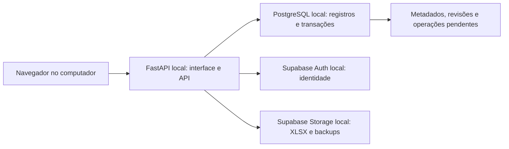

# Migração do Simpress para Supabase — Etapa 2

**Data:** 09/10/2026, America/Sao_Paulo.

**Status:** arquitetura aprovada por Gabriel em 09/10/2026; conta única administradora e retenção operacional de 60 dias confirmadas. Preparação local autorizada e Etapa 3 solicitada. A implementação permanece nas etapas seguintes.

**Referências do projeto:** [etapa 1](migracao_supabase_etapa_1.md), [escopo das etapas 2 a 8](prompts_migracao_supabase_etapas_2_a_8.md) e [regras do projeto](../../../AGENTS.md).

## Decisão confirmada nesta etapa

Gabriel informou: **“Quero usar no local, por enquanto, antes de lançar online.”** O desenvolvimento e o ensaio de migração serão planejados para o computador local. Publicação online será uma evolução posterior, com configuração, orçamento e autorização próprios.

Gabriel aprovou executar também PostgreSQL, Auth e Storage localmente pelo Supabase CLI no piloto. A aprovação define a arquitetura, sem afirmar que o ambiente esteja instalado ou a base oficial tenha sido trocada. Um FastAPI local conectado ao Supabase remoto é uma alternativa posterior, se houver necessidade de sincronizar computadores antes de publicar a aplicação.

## Estado atual reconfirmado

- FastAPI entrega a interface em `/` e os recursos em `/static`; o iniciador usa `127.0.0.1` (`main.py:3496`, `3502`, `3519`).
- O middleware restringe Host e Origin às autoridades locais. Ele não substitui autenticação de usuário (`main.py:1450-1496`; `README.md:285`).
- A retenção executada usa `HISTORY_RETENTION_DAYS = 60`; a referência a 90 dias é um docstring divergente (`core/config.py:23`; `main.py:1715-1718`).
- A limpeza atual protege o evento de comparação fixado e preserva eventos cuja data não permite classificá-los como expirados (`main.py:1732-1736`, `1745-1756`). Essas exceções precisam ser portadas.
- A atualização de planilhas prepara o estado sem publicá-lo antes da confirmação da operação (`domains/inventory_update.py:412-415`; fluxo de commit descrito na etapa 1).
- As anotações têm limite de 2.000 caracteres, identidade por linha/evento e fingerprint dos dados (`domains/history_annotations.py:12`, `20`, `48-78`; `AGENTS.md`).
- Nenhum driver PostgreSQL ou cliente Supabase consta em `requirements.txt`. `docker` e `supabase` não foram encontrados no PATH nesta sessão; isso não prova ausência em todos os locais do computador.

A inspeção foi restrita a código, documentação e disponibilidade de comandos. Conteúdo das planilhas e JSON operacionais não foi aberto.

## Arquitetura recomendada para o piloto local

O FastAPI continuará servindo frontend e API na mesma origem. Isso preserva o contrato das rotas e evita introduzir uma segunda hospedagem para a interface. A pilha local do Supabase fornece PostgreSQL, Auth e Storage no computador e permite desenvolvimento sem consumir a cota de um projeto hospedado. A preparação requer CLI e um runtime de contêiner compatível com as APIs Docker. [Supabase local](https://supabase.com/docs/guides/local-development)

O aplicativo e todas as portas publicadas pela pilha de desenvolvimento devem ficar restritos ao loopback. Manter somente o FastAPI em `127.0.0.1` não garante que as portas dos contêineres também estejam restritas. Esse isolamento precisa ser conferido na Etapa 4. A documentação orienta restringir a rede local da pilha e não expor o ambiente de desenvolvimento publicamente. [Rede da pilha local](https://supabase.com/docs/guides/local-development)

Mantenha o repositório atual. Código do aplicativo, futuras migrations em `supabase/migrations/`, configuração sem segredos e relatórios em `docs/` devem evoluir juntos. A implementação deve usar uma branch própria quando solicitada; nenhuma branch nova foi criada nesta etapa. O diretório inicializado pelo CLI é versionável e sua criação não exige vincular o projeto a uma conta remota. [Supabase CLI](https://supabase.com/docs/guides/local-development/cli/getting-started)

### Alternativas e recomendação de hospedagem

- **Agora — FastAPI e Supabase locais:** recomendado para desenvolver e ensaiar. Exige recursos do computador, organização dos volumes e backup próprio. Não oferece sincronização entre computadores nem disponibilidade com o computador desligado.
- **Intermediário — FastAPI local e Supabase remoto:** útil se for necessário centralizar dados antes da publicação. Exige internet para operações dependentes do banco, autorização para enviar os dados e revisão das cotas. Não será adotado implicitamente.
- **Depois — FastAPI hospedado e Supabase remoto:** recomendado como arquitetura online, preservando a interface servida pelo FastAPI. Um serviço gerenciado compatível com Python, como Render Web Service, é um candidato concreto. O provedor final e o plano dependem do orçamento e da medição de memória/tempo dos XLSX. [FastAPI no Render](https://render.com/docs/deploy-fastapi)
- **Reescrever o backend para Edge Functions:** não recomendado para esta migração. O runtime documentado é Deno/TypeScript; substituir FastAPI e o processamento Python de planilhas aumentaria o escopo e exigiria nova validação das regras existentes. [Supabase Edge Functions](https://supabase.com/docs/guides/functions)

Na versão online, o processo deve usar a porta e o listener exigidos pelo provedor, atrás de HTTPS, e uma lista explícita de hosts/origins. A regra atual de autoridades locais precisa ser adaptada por ambiente. Disco temporário poderá servir para processamento, mas não será a fonte persistente. O Render gratuito suspende o serviço após inatividade e perde arquivos locais em reinícios; a documentação não o recomenda para produção. [Limitações do Render gratuito](https://render.com/docs/free)

## Responsabilidade de cada armazenamento

**PostgreSQL será a fonte dos registros ativos após um cutover validado.** Guardará inventário, referências auxiliares, unidades, apelidos, eventos, resultados detalhados, anotações, revisões e metadados de arquivos. A Etapa 3 definirá tabelas e restrições; este relatório não antecipa o esquema físico.

**Storage guardará os arquivos binários.** XLSX originais, modelos versionados e artefatos de backup ficarão em buckets privados, com referências no banco. Os downloads passarão pelo backend autorizado; links assinados de curta duração poderão ser avaliados depois. Buckets privados submetem downloads às regras de acesso, enquanto URLs de buckets públicos permitem leitura por quem as possui. [Buckets privados](https://supabase.com/docs/guides/storage/buckets/fundamentals)

Cada arquivo de entrada deve ser preservado como evidência imutável, com hash, tamanho, nome original, fonte e evento. Edições posteriores ocorrerão no banco. Portanto, o XLSX original poderá diferir do estado editado: a exportação deverá aplicar os valores ativos ao modelo/pacote adequado, preservando partes nativas quando necessário. Uma restauração precisa incluir o estado lógico editado e suas referências; restaurar só o arquivo de entrada perderia edições feitas depois da importação.

Os XLSX de exportação gerados sob demanda poderão continuar como downloads temporários. Não há necessidade de armazenar permanentemente toda exportação. Modelos distribuídos com o aplicativo devem ter uma versão identificável e possibilidade de recuperação.

Durante a migração, o modo atual de arquivos permanece como operação vigente até uma mudança explícita e validada. O backend de persistência será escolhido por configuração, com uma fonte de gravação ativa por ambiente. Não recomendo escrita simultânea em XLSX/JSON e PostgreSQL: isso criaria dois estados passíveis de divergência.

## Acesso ao PostgreSQL e transações

Recomendo acesso SQL pelo FastAPI, com uma camada de persistência que preserve as regras de domínio. Um driver PostgreSQL com pool limitado permite transações envolvendo várias entidades, controle de revisão e recuperação. A escolha e o versionamento da biblioteca ficam para a Etapa 5, considerando o Python e as dependências atuais.

A alternativa é realizar operações pela Data API e encapsular alterações atômicas em funções de banco. Ela pode ser adequada a aplicativos novos, mas distribuir a operação atual em chamadas HTTP independentes não reproduziria a atomicidade dos arquivos. Por isso, o acesso SQL no backend é a proposta para este projeto.

No piloto, a conexão será ao PostgreSQL local. Na hospedagem futura, uma conexão direta com pool da aplicação é adequada ao processo persistente; se a rede do provedor for apenas IPv4, o pooler em modo sessão é a alternativa documentada. O modo transação tem limitações de estado de sessão e exige análise específica antes de uso. [Conexões PostgreSQL](https://supabase.com/docs/guides/database/connecting-to-postgres)

Use credenciais distintas para migrations/administração e execução normal. A role de execução deve ter somente os privilégios necessários, sem superusuário, propriedade das tabelas ou `BYPASSRLS`. O schema de negócio não precisa ser exposto pela Data API; se ela não tiver consumidor, sua desativação pode ser avaliada. [Proteção dos dados](https://supabase.com/docs/guides/database/secure-data)

Autenticar uma requisição no FastAPI não configura automaticamente a identidade da conexão SQL. A aplicação precisará estabelecer o contexto verificado do usuário por transação, aplicar as políticas correspondentes e impedir vazamento desse contexto entre conexões reutilizadas. A Etapa 7 deve demonstrar permissões permitidas e negadas no banco, além das verificações nas rotas. RLS é complementar aos privilégios SQL, e roles privilegiadas podem ignorá-la. [RLS](https://supabase.com/docs/guides/database/postgres/row-level-security)

## Usuários, autenticação e autorização

**Confirmado: uma conta individual administradora inicialmente**, cadastrada de forma controlada, sem cadastro público. Perfis de equipe ficam como possibilidade futura. Se houver equipe depois, cada pessoa terá sua conta; compartilhamento de senha impediria atribuir ações corretamente.

Supabase Auth local deverá ser usado para desenvolver o login antes da publicação online. O FastAPI validará a identidade e a permissão para cada operação, inclusive exportação, download, restauração e anotação. Sessões deverão permitir renovação, encerramento e revogação. O frontend manterá a comunicação com a API do FastAPI.

Como proposta para a mesma origem, use sessão do aplicativo por cookie HttpOnly, com proteção contra CSRF, escopo restrito e armazenamento protegido dos tokens necessários no servidor. Cookies Secure e HTTPS serão obrigatórios online; qualquer exceção de desenvolvimento deve estar limitada ao modo loopback. Assinatura e claims de tokens devem ser verificados com biblioteca apropriada; apenas decodificar o JWT é insuficiente. [Verificação de JWT](https://supabase.com/docs/guides/auth/jwts)

Para a eventual equipe, proponho três perfis para avaliação: **consulta** lê/exporta; **operador** também edita dados e anotações; **administrador** também gerencia usuários, importa, restaura e executa ações de retenção. Essa divisão é uma recomendação, não uma política aprovada. Permitir importação ao operador, por exemplo, precisa de escolha explícita. A base será tratada como um inventário organizacional comum; não será inventada propriedade individual de cada equipamento.

Chaves secretas/administrativas ficam no servidor e apenas em fluxos que precisam delas. Para serviços HTTP, prefira as chaves atuais publishable/secret quando suportadas, sem reutilizar valores legados em exemplos. Uma chave secret pode ignorar RLS; sua presença no backend não prova que o acesso do usuário está protegido. Clientes Auth/Storage com sessão de usuário devem ser isolados por requisição, sem estado de autenticação global compartilhado. [Chaves do Supabase](https://supabase.com/docs/guides/getting-started/api-keys)

## Atualizações, concorrência e caches

O piloto começa com um processo de aplicação. Mesmo assim, o controle de concorrência deve estar no banco: bloqueios Python não coordenam futuros processos ou máquinas. Edições verificarão uma revisão esperada; alterações concorrentes produzirão conflito explícito, sem sobrescrita silenciosa.

Uma revisão compartilhada do estado ativo deve avançar na mesma transação que confirma inventário, apelidos ou unidades. Os caches derivados serão identificados por essa revisão. Uma requisição que precise reconstruir dados deve ler um snapshot coerente, e a revisão usada pelo resultado deve acompanhar a resposta. A definição das transações e do isolamento será detalhada com o esquema.

Após commit, o processo publica o estado preparado ou invalida seu cache. Outras instâncias compararão a revisão do banco antes de reutilizar estado. Notificações ou Realtime poderão acelerar a atualização, mas não serão a única forma de detectar mudanças: uma mensagem perdida não pode deixar o inventário antigo indefinidamente. Não recomendo acrescentar um serviço de cache distribuído ao piloto.

## Consistência entre PostgreSQL e Storage

Banco e Storage não participam de uma única transação da aplicação. A proposta é publicar a nova versão somente depois de validar os arquivos e confirmar que os objetos necessários estão disponíveis.

1. Criar uma operação identificável, com chave de idempotência por solicitação e revisão esperada do estado ativo. Uma nova atualização intencional terá evento próprio, mesmo que reutilize arquivos iguais.
2. Validar os dois XLSX, os limites e o conteúdo; preparar a comparação e os metadados sem alterar o estado ativo.
3. Gravar objetos em caminhos imutáveis, conferir integridade e registrar os arquivos preparados. O hash pode permitir reutilizar conteúdo, mas não deve fundir eventos ou IDs de anotação.
4. Em uma transação PostgreSQL, confirmar registros, referências, histórico, resultado, anotações reaplicáveis e revisão ativa. Se a revisão esperada mudou, registrar conflito e não publicar o candidato.
5. Depois do commit, atualizar caches e confirmar a operação ao cliente. Se a resposta se perder, uma repetição com a mesma chave deve recuperar o resultado confirmado.

Falha antes do commit deixa a versão anterior ativa. Objetos preparados sem referência serão candidatos a limpeza posterior, após período de segurança e nova verificação de referências. Falha depois do commit exige recuperar o estado confirmado, sem desfazer a operação por presumir que a ausência de resposta significa falha.

O estado das operações ficará no banco, permitindo retomada após reinício. Um executor com posse temporária e retries limitados poderá concluir tarefas pendentes; a exclusão de objetos também deve ser registrada como pendência repetível. Tarefas importantes não dependerão exclusivamente de callbacks em memória. Nenhuma limpeza removerá objetos ainda referenciados por inventário, histórico, modelos, restaurações ou backups protegidos.

## Regras funcionais que a arquitetura deve preservar

- A base oficial continua sendo a entrada válida Simpress; o InvAll continua auxiliar. Não completar o inventário com equipamentos encontrados somente na fonte auxiliar.
- Preservar série bruta e normalizada, duplicidades, fonte, aba/linha quando aplicável e identidade própria do registro. Uma série isolada não pode ser presumida como chave universal única.
- Manter valores brutos de comparação e IDs auditáveis. Rótulos de exibição/exportação seguem os contextos definidos em `AGENTS.md`.
- Anotações continuam por linha e evento, com limite de 2.000 caracteres, inclusive nas listas agrupadas e exportações. O outbox/rascunho local não substitui uma gravação confirmada no servidor.
- Reaplicar anotação somente na mesma seção e com todos os dados iguais, ignorando apenas `anotacao` e `anotacao_id`. A ocorrência mais recente vazia e conflitos entre duplicados impedem reaproveitamento de texto mais antigo. Cada evento novo recebe identidade independente.
- A migração deve preservar anotações legadas e permitir consulta central sem depender da existência do histórico no clone. O novo desenho não pode eliminar dados brutos necessários à interpretação da anotação.
- A substituição da sincronização por pasta compartilhada exige validação específica. Como `AGENTS.md` atualmente exige essa sincronização, sua retirada futura deverá ser autorizada e acompanhada da atualização dessa regra; não será consequência automática de configurar o Supabase.

## Retenção e recuperação de desastres

**Confirmado: 60 dias para históricos e backups operacionais**, mantendo a configuração executada hoje. Esta decisão resolve a divergência de 60/90 dias; a implementação futura deverá corrigir o comentário divergente e preservar as exceções abaixo. Nenhum expurgo foi executado nesta etapa.

Eventos fixados, arquivos ativos, modelos em uso e objetos referenciados não entram em exclusão por idade. Registros com data inválida precisam de revisão, não expurgo presumido. Para anotações e os resultados necessários à sua interpretação, recomendo suspender exclusão automática durante a migração e definir um ciclo de vida próprio antes de ativar limpeza. Escolher 60 dias para o histórico não autoriza, por si só, uma cascata destrutiva nas anotações.

Retenção operacional e backup de desastre são diferentes. O primeiro permite consultar/restaurar eventos; o segundo recupera o serviço se o computador, banco ou armazenamento falhar. A cópia de desastre precisa conter um snapshot coerente do banco, os objetos Storage referenciados, um manifesto de versões/hashes e instruções de restauração, em destino aprovado separado do ambiente ativo. Um backup PostgreSQL do Supabase não inclui os objetos do Storage. [Escopo dos backups](https://supabase.com/docs/guides/platform/backups)

Volumes ativos do banco e Storage devem ficar sob o runtime local, fora da sincronização de arquivos do OneDrive. O repositório pode continuar na pasta atual. Somente artefatos de backup concluídos, consistentes e protegidos devem ser enviados a um destino de backup autorizado; copiar continuamente arquivos internos de um banco em execução não constitui esse procedimento.

Como metas iniciais para discussão, proponho backup diário com **RPO de até 24 horas** e restauração local em **RTO de até 4 horas**. RPO é a perda máxima de alterações aceita; RTO é o tempo de recuperação. São metas propostas, não garantias ou tempos medidos. Se a operação não aceitar perder um dia de edições, será necessária frequência maior antes do uso oficial. Destino, retenção do backup de desastre e tolerâncias precisam ser definidos antes do cutover, sem bloquear o desenho preliminar da Etapa 3.

## Ambientes e rollback

**Desenvolvimento:** banco e Storage locais descartáveis com fixtures/sanitizados, migrations versionadas e segredos fora do Git. Reset de banco só nesse ambiente identificado como descartável.

**Homologação:** instância local separada ou execução isolada com identidade, portas e volumes próprios, contendo cópias autorizadas e permitindo ensaio de importação/restauração. Não compartilhar credenciais nem volumes com a base ativa. Quando o lançamento online for solicitado, validar também a configuração em homologação remota separada antes da produção. [Gestão de ambientes](https://supabase.com/docs/guides/deployment/managing-environments)

**Uso oficial local:** somente após reconciliação e restauração ensaiadas. Terá volumes persistentes, backup externo, versão identificável da aplicação e rotinas de recuperação. O stack de desenvolvimento local não será declarado pronto para uso oficial apenas porque iniciou.

**Produção online futura:** aplicação hospedada, Supabase remoto, HTTPS, configuração própria de Auth/Storage, backups e monitoramento. A disponibilidade de CPU, memória, tempo e limites para dois uploads de até 30 MiB precisa ser medida; não foi dimensionada nesta etapa.

Antes do cutover, o rollback é manter a versão vigente e as fontes originais preservadas. Depois que houver gravações no banco novo, voltar aos XLSX/JSON antigos perderia essas edições. O procedimento passa a exigir suspensão de gravações, exportação/reconciliação do estado novo para um formato validado pelo modo anterior, preservação de IDs/anotações e então troca controlada. Se esse caminho não estiver demonstrado, recuperar o ambiente novo por backup é a opção a ensaiar. Não haverá fallback automático para arquivos desatualizados quando o banco ficar indisponível.

O teste de rollback também deve conferir o comportamento do backup e dos objetos Storage, não apenas o retorno HTTP. As Etapas 4 a 7 implementam os componentes; a Etapa 8 ensaia a migração e o rollback. A entrada efetiva em uso oficial, local ou online, requer solicitação posterior.

## Custos e pré-requisitos

Supabase local não exige assinatura da plataforma nem consome cota de projeto hospedado. Haverá uso de disco, memória e download das imagens. Antes da Etapa 4, é necessário escolher e preparar CLI/runtime compatível. Docker Desktop possui condições de gratuidade para uso pessoal e determinadas organizações; uso profissional em organizações maiores pode exigir assinatura. Confirmar o licenciamento aplicável ou escolher um runtime compatível aprovado evita presumir gratuidade corporativa. [Supabase local](https://supabase.com/docs/guides/local-development) · [Licença Docker Desktop](https://docs.docker.com/subscription-billing/desktop-license/)

O lançamento online terá orçamento separado para hospedagem Python, serviços Supabase conforme cotas, backup e eventuais e-mail/domínio. O plano gratuito do Supabase consultado oferece 500 MB de banco e 1 GB de Storage, admite arquivos de até 50 MB e não inclui backups automáticos; também prevê pausa por inatividade. Isso pode atender um piloto, mas não demonstra adequação ao volume real. [Preços e cotas consultados em 09/10/2026](https://supabase.com/pricing)

Como cenário de dimensionamento, um par de arquivos de 30 MiB por dia durante 60 dias totaliza 3.600 MiB antes de modelos e outros artefatos, sem deduplicação. Esse cenário hipotético ultrapassa 1 GB; não representa o volume medido do projeto. A capacidade real depende do tamanho médio, frequência de atualização, deduplicação, retenção e tráfego. Esses dados serão necessários antes de contratar um plano online.

## Decisões aprovadas e critérios para a Etapa 3

1. **Usuários e perfis:** conta única administradora inicial, confirmada. Não implementar perfis de equipe ou multitenancy agora.
2. **Retenção operacional:** 60 dias, confirmados, mantendo exceções do comportamento atual. Anotações e dados necessários à sua interpretação ficam protegidos de exclusão automática durante a migração; a política específica deve ser definida antes de ativar seu expurgo.
3. **Proposta técnica:** aprovada. Supabase local, PostgreSQL como futuro estado ativo, Storage privado, acesso pelo FastAPI, uma fonte de gravação por ambiente e publicação após commit.
4. **Pré-requisitos:** execução autorizada. Gabriel escolheu `Backup_Banco/` dentro do Simpress como destino local; pasta criada e excluída do Git. A tentativa de preparação do WSL não concluiu e o gerenciador de instalação não pôde ser iniciado nesta sessão. O detalhamento e as pendências estão no [relatório de pré-requisitos locais](migracao_supabase_pre_requisitos_locais.md). Provedor, região e orçamento online continuam como evolução posterior, conforme o uso local escolhido.

A Etapa 3 foi solicitada expressamente. Seu modelo deve incorporar conta única, retenção de 60 dias e identificação de políticas por entidade. Migrations, integração e importação permanecem nas etapas posteriores. O impedimento de instalação do runtime não bloqueia o desenho documental do esquema.

## Verificações da entrega original da Etapa 2 e limites

- Releitura dos relatórios e `AGENTS.md`; conferência no código dos pontos de listener, frontend, acesso local, retenção, exceções de limpeza, preparação de estado e identidade de anotações.
- Consulta à documentação oficial para pilha local, conexão PostgreSQL, Auth/JWT, chaves, RLS, Storage, backups, ambientes, hospedagem candidata e custos/licenciamento.
- Conferência da disponibilidade de CLI/runtime apenas pelo PATH; não foi feita instalação, inicialização ou tentativa de conexão.
- Conferência do documento passou: blocos Markdown fechados, ausência de espaços ao final das linhas, três links locais existentes e oito referências explícitas de código com linhas dentro dos respectivos arquivos. A revisão de conteúdo cobriu todos os temas do escopo da Etapa 2.
- `git diff --check` passou para os arquivos rastreados; `git diff --stat` permaneceu vazio. O relatório novo, ainda não rastreado, foi conferido separadamente. O estado final contém somente os três documentos não rastreados: Etapa 1, Etapa 2 e prompts.
- Testes da aplicação não foram repetidos, pois esta etapa altera somente documentação. As limitações da suíte registradas na Etapa 1 continuam válidas; esta análise não valida código de integração, políticas RLS, desempenho, rede, restauração ou ambiente online.

**Entrega original da Etapa 2:** somente este relatório. Após a aprovação do usuário, ele foi atualizado para registrar as escolhas; a preparação de `Backup_Banco/`, a exclusão no Git e as tentativas de instalação estão documentadas no relatório de pré-requisitos locais. Os documentos da Etapa 1 e dos prompts foram preservados. Nenhum código da aplicação, planilha, JSON operacional ou configuração remota foi alterado; nenhum commit/push foi realizado.
