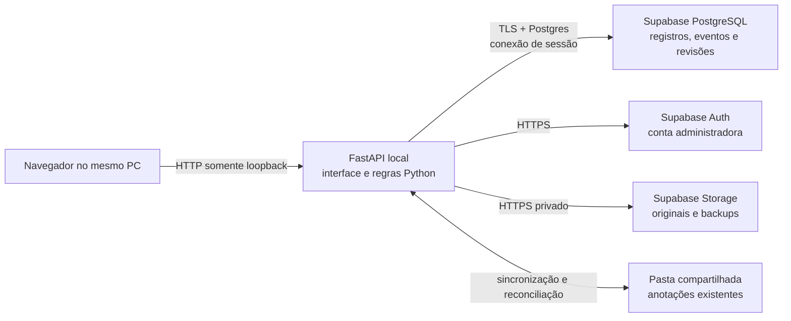

# Simpress no PC local com Supabase Free remoto — Etapa 9

**Data:** 09/10/2026
**Escopo:** análise da arquitetura e do plano de implantação. Nenhum código, dado operacional ou recurso remoto foi alterado.

## Recomendação

É tecnicamente viável executar o FastAPI no computador local e conectar o backend pela internet ao PostgreSQL, ao Auth e ao Storage de um projeto Supabase Free. A aplicação e o processamento de planilhas continuam no PC; os registros e arquivos que forem migrados passam a ficar no projeto remoto.

Para uma pessoa, em um único computador ligado e com internet estável, essa arquitetura é adequada para desenvolvimento, avaliação e uso de baixa criticidade, desde que haja backup independente. Ela também centraliza dados para clones que sejam configurados com as mesmas credenciais do projeto. O FastAPI continua disponível somente enquanto o PC estiver ligado. O uso de telas e rotas que leem o banco ou o Storage fica dependente da conexão remota; não há modo offline com gravação local sincronizada automaticamente.

**Recomendação de saída:** continuar para homologação com fixtures sintéticas. Ainda não recomendar o Supabase Free como única cópia oficial dos dados operacionais. O plano pode pausar projetos após uma semana de inatividade, não inclui backups diários e não oferece SLA. A decisão de uso oficial exige backup próprio, recuperação demonstrada e aprovação do envio de dados para a região do projeto.

## Estado confirmado e limite da consulta

Na leitura autenticada mais recente do painel, em 09/10/2026, o projeto `weuqeergonkcxwzflxdo` aparecia assim:

| Campo | Resultado observado |
|---|---|
| Nome e branch | Projeto Simpress; `main PRODUCTION` |
| Saúde e plano | Healthy; Free |
| Região | Oregon, EUA (`us-west-2`) |
| Migrations | O painel informava nenhuma migration recente |
| Schema público | Table Editor não mostrava tabelas ou views |
| Storage | A tela oferecia criar o primeiro bucket |
| Backups | O painel informava nenhum backup |
| Compute | Sem acesso para a organização; recurso em alfa privada |

**Não foi possível repetir essa leitura nesta execução:** a aba atual do Supabase redireciona para a tela de login. Portanto, os valores da tabela são o último estado que foi confirmado, não uma confirmação ao vivo. Não tentei autenticar novamente nem usei credenciais. O nome `main PRODUCTION` foi tratado como sinal de que o projeto deve ser protegido como produção, ainda que o painel anteriormente não exibisse o esquema Simpress.

As migrations do repositório foram exercitadas em pilhas Supabase locais descartáveis. Isso não comprova que possam ser aplicadas diretamente ao Supabase Cloud. Nenhuma migration, tabela ou bucket foi criado no projeto remoto.

## Adequação do plano Free

A página oficial consultada lista US$ 0 por mês, 500 MB de banco, 1 GB de Storage, 5 GB de saída, RAM de 500 MB, limite de upload de 50 MB, sem backups automáticos, e pausa após uma semana de inatividade. Também informa limite de dois projetos ativos e ausência de SLA. Os detalhes podem mudar; reconfira antes do uso. [Planos e cotas atuais](https://supabase.com/pricing) · [Pausa do plano Free](https://supabase.com/docs/guides/platform/free-project-pausing)

O limite de upload do Free é maior que o limite de 30 MB por arquivo que o aplicativo aceita hoje. Isso não garante que a integração esteja pronta: é preciso medir o tamanho real dos objetos e o crescimento acumulado de originais e backups. Como cenário de estresse, guardar dois XLSX de até 30 MiB em cada atualização diária por 60 dias ocuparia até 3.600 MiB antes de modelos e artefatos auxiliares, acima de 1 GB. É o pior caso permitido pelas configurações, não uma previsão do tamanho real do histórico.

Os backups automatizados de banco são oferecidos a partir do plano Pro; além disso, backup de banco não restaura os bytes de objetos Storage que tenham sido excluídos depois do ponto salvo. Para permanecer no Free, o projeto precisa de rotina independente que reúna PostgreSQL, arquivos referenciados, manifesto e elementos necessários à recuperação. [Escopo dos backups Supabase](https://supabase.com/docs/guides/platform/backups)

## Alternativas avaliadas

| Arquitetura | O que oferece | Limites para este projeto | Adequação |
|---|---|---|---|
| FastAPI + Supabase CLI local | Backend e banco ficam no PC; fixtures e desenvolvimento sem cota hospedada; pode continuar sem internet | Exige runtime/recursos locais e gestão de volumes; não centraliza o banco entre computadores; execução local atual segue piloto | Melhor para desenvolvimento e ensaio |
| **FastAPI local + Supabase Free remoto** | Mantém a interface atual no PC e centraliza PostgreSQL/Auth/Storage; custo Supabase de US$ 0 dentro das cotas Free | Depende de internet; PC precisa ficar ligado; pausa por inatividade; sem backup diário/SLA; transferência de dados ao Oregon | **Adequada para piloto e uso individual de baixa criticidade com backup independente** |
| FastAPI hospedado + Supabase remoto pago | Disponibilidade sem depender do PC, acesso central pelo navegador, opções de backup/retenção melhores | Exige provedor Python separado, custo recorrente e adaptação de TLS/hosts; o Supabase sozinho não hospeda a aplicação Python por padrão | Melhor se outras pessoas precisarem acessar mesmo com o PC desligado |
| FastAPI como Edge Functions | Coloca endpoints em funções administradas no Supabase | Exige reescrita de FastAPI e fluxos de XLSX em outro runtime; Edge Functions têm limites próprios de memória e CPU | Não recomendada para esta migração |

As Edge Functions documentam 256 MB de memória e 2 segundos de CPU por requisição, restrições inadequadas como substituição direta deste backend que processa arquivos e preserva fluxos Python. [Limites de Edge Functions](https://supabase.com/docs/guides/functions/limits)

Supabase Compute poderia hospedar serviços de longa duração em qualquer linguagem, mas no painel o acesso estava indisponível e a oferta está em alfa privada. O próprio Supabase limita o uso da alfa a avaliação interna, não a produção. Não é uma dependência adequada ao plano de implantação. [Supabase Compute](https://supabase.com/compute)

## Arquitetura recomendada

O FastAPI continua servindo o frontend e a API na mesma origem local, sem expor uma porta à rede local ou à internet. O navegador fala com `127.0.0.1`; as chamadas ao Supabase partem do processo Python e usam TLS. Chaves administrativas ficam no computador/ambiente do servidor e nunca são enviadas ao JavaScript.

O cliente SQL atual é um processo backend persistente com pool psycopg. Para rede somente IPv4, o Supabase documenta o pooler compartilhado em modo de sessão como alternativa a conexão direta; modo de transação tem limitações de estado de sessão e prepared statements. A escolha depende da conectividade IPv4/IPv6 do PC e deve ser verificada no painel Connect. O código atual fixa `127.0.0.1` e portas do piloto nos validadores e no construtor do pool; isso precisa mudar antes de habilitar uma URL hospedada. Use TLS e validação do certificado, role de runtime limitada e credencial de migration separada. [Conexões PostgreSQL Supabase](https://supabase.com/docs/guides/database/connecting-to-postgres)

Supabase Auth e Storage também têm clientes com URLs `127.0.0.1` e portas locais no piloto. A adaptação precisa aceitar endpoints HTTPS do projeto remoto, sem expandir o listener local, permitir origens arbitrárias ou colocar segredos no cliente.

## Mapa das mudanças e riscos

| Área | Estado no repositório | Trabalho necessário antes do remoto |
|---|---|---|
| Servidor e frontend | FastAPI/Uvicorn servem a interface; listener em `127.0.0.1`; restrições de Host/Origin locais | Manter a fronteira local e conectar ao Supabase somente do backend |
| PostgreSQL | `files` é padrão; backend SQL só aceita `simpress-dev` local; host, porta e role são fixos | Adicionar perfil hospedado explícito, pool/TLS/certificado e teste de conexão sem fallback para arquivos velhos |
| Auth | Piloto local limita URL Auth e cookie à configuração loopback; conta administradora única, sem cadastro público | Validar issuer/assinatura do Auth remoto, proteger sessão/cookie/CSRF e configurar as URLs de retorno para a origem local |
| Storage | Bucket privado e cliente HTTP usam serviço local | Endpoint remoto HTTPS, bucket privado, políticas mínimas e confirmação de hash/tamanho; conferir cota e tamanho acumulado |
| Migrations/RLS | Seis migrations verificadas na pilha local; RLS e roles próprias | Revisar compatibilidade Cloud, roles gerenciadas, schemas privados, privilégios e políticas com migrations aplicadas somente após gate próprio |
| Estado e caches | Snapshot por requisição no Postgres piloto; locks e caches do modo de arquivos são locais ao processo | Medir latência até Oregon, verificar concorrência/revisões e assegurar que falha remota não sirva cache obsoleto como estado atual |
| Anotações | Pasta compartilhada e outbox no modo atual; SQL piloto centraliza anotações sem sincronização bidirecional automática com OneDrive | Construir sincronização e reconciliação para a pasta configurada, clones sem histórico local e conflitos. Não desligar nem abandonar a pasta |
| Backup e rollback | Ensaio de recuperação usa fixtures locais; rotina não é backup diário do projeto remoto | Automatizar/exportar dados e objetos, proteger a chave fora do PC e demonstrar recuperação fora da instalação de origem |
| Dados/região | O projeto anterior estava em Oregon | Medir latência; obter autorização organizacional antes de transferir arquivos/histórico reais para essa região |

As regras do `AGENTS.md` permanecem requisitos: seis seções anotáveis, IDs estáveis por evento/linha, limite de 2.000 caracteres, exportação, sincronização com a pasta compartilhada, clones sem histórico local e reaplicação somente por igualdade completa na mesma seção. Os dados brutos e IDs de auditoria não podem ser normalizados nem sobrescritos pela camada de apresentação.

O histórico operacional usa 60 dias. Esse prazo não autoriza purgar notas, fontes, backups ou arquivos referenciados automaticamente; o ciclo de retenção dessas relações precisa acompanhar o backup e o plano de recuperação.

## Custos e dimensionamento

- **Supabase Free:** US$ 0 por mês dentro das cotas, sem backup diário e com possibilidade de pausa. O processamento Python continua usando CPU, RAM e disco do computador local.
- **Hospedagem do FastAPI:** nenhum custo enquanto o servidor continuar somente no PC. Um serviço Python remoto será um item separado se a aplicação precisar funcionar sem o PC ligado.
- **Backup externo:** custo depende de destino, retenção e tamanho medido; não está estimado nesta etapa.
- **Migração de dados:** não há custo Supabase de implantação dentro da quota, mas consumo de Storage/egress precisa ser medido e respeitar o limite de 1 GB/5 GB.

Os limites atuais do código são de 30 MB por arquivo e 60 dias de retenção operacional. Como o repositório não contém uma medição aprovada do crescimento real em nuvem, a homologação deve calcular bytes de cada entrada, quantidade de atualizações e projeção de retenção antes da carga real. Planeje alertas locais ao atingir 70% da quota de banco, Storage e saída como margem operacional; isso é uma proposta de proteção, não recurso que presumo habilitado no plano Free.

## Plano em etapas e esforço preliminar

As estimativas abaixo são dias de trabalho técnico aproximados, aproveitando o piloto já implementado. Não incluem espera por credenciais, autorização de dados ou suporte do provedor; são uma estimativa, não prazo garantido.

| Etapa | Entrega/critério de saída | Esforço estimado |
|---|---|---:|
| 9. Arquitetura e compatibilidade remota | Este relatório; riscos e gates definidos | Concluída nesta execução |
| 10. Configuração PostgreSQL hospedada | Perfil remoto separado e seguro; modo files/local inalterados; URL jamais registrada | 1–2 dias |
| 11. Auth, sessão e segurança | Fluxo da conta única contra Auth remoto; testes positivos/negativos, CSRF e RLS documentados | 2–4 dias |
| 12. Storage, anotações e backup | Bucket privado remoto, sincronização da pasta de anotações e recuperação com fixtures | 2–4 dias |
| 13. Ensaios locais e pré-checagem de leitura | Sem dados reais; integração e falhas simuladas; estado remoto lido e confirmado | 1–2 dias |
| 14. Schema e fixture sintética no remoto | Diferença SQL revisada; migrations e objeto artificial aplicados somente com autorização específica | 0,5–1,5 dia |
| 15. Migração real e ativação | Dry-run aprovado, backup recuperável, reconciliação zero diferenças inexplicadas, uso de uma única fonte | 1–3 dias mais janela operacional |

## Critérios para seguir

### Prosseguir para desenvolvimento remoto

- Usar primeiro somente a pilha Supabase local com fixtures para testar configurações que ainda não aceitam o Supabase Cloud.
- Rever permissões e migrations para a variante Cloud antes de mudar o projeto `main PRODUCTION`.
- Manter modo `files` como padrão; a escolha de `hosted` deve ser explícita e falhar fechado se conexão, Auth ou Storage estiverem fora do ar.
- Manter o FastAPI em loopback; transmitir tráfego ao Supabase com TLS e chaves somente no processo local.
- Não enviar arquivos reais durante as Etapas 10–14; fixtures sintéticas e relatório de hashes/tamanhos bastam para a homologação técnica.

### Antes de migrar dados reais

- Confirmar o estado atual e identidade do projeto remoto; a verificação da Etapa 9 não pôde ser repetida porque o painel está em tela de login.
- Obter aprovação para a região Oregon e transferência dos arquivos/históricos aplicáveis.
- Implementar rotina independente para SQL, Storage, manifests e chaves; restaurar uma cópia em destino separado antes da troca.
- Medir uso de banco, Storage e egress com volume representativo e revisar retenção de 60 dias, sem purga em cascata de anotações ou fontes referenciadas.
- Parar gravações no modo antigo durante captura final e manter apenas uma fonte gravável após a reconciliação.
- Exigir contagens, IDs, payloads originais, hashes, anotações e relações sem diferenças inexplicadas. Se algo falhar, não ativar o novo backend.

### Reavaliar a escolha do Free

Trocar para Pro ou outra estratégia de hospedagem/backup antes do uso oficial se for necessário impedir pausa por inatividade, exigir backups diários gerenciados, receber suporte com SLA, exceder as cotas ou depender de disponibilidade além do PC local.

## Fontes e evidências

- Painel Supabase do projeto consultado anteriormente em 09/10/2026; sem leitura autenticada nesta execução.
- `AGENTS.md`, `README.md` e documentação local das Etapas 1–8.
- Inspeção de `main.py`, `core/config.py`, `persistence/config.py`, `persistence/postgres.py`, `persistence/storage.py`, `persistence/boundary.py`, `security/config.py` e `domains/history_annotations.py`.
- Documentação oficial: [Planos e cotas](https://supabase.com/pricing), [pausa do Free](https://supabase.com/docs/guides/platform/free-project-pausing), [conexões PostgreSQL](https://supabase.com/docs/guides/database/connecting-to-postgres), [backups e Storage](https://supabase.com/docs/guides/platform/backups) e [limites Edge Functions](https://supabase.com/docs/guides/functions/limits).

Esta etapa foi somente documental; nenhum teste foi executado nem código ou dado operacional foi alterado.
